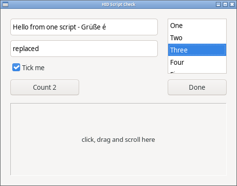
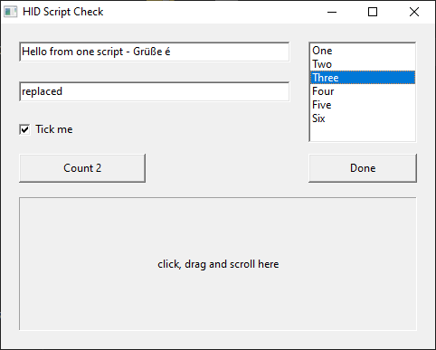
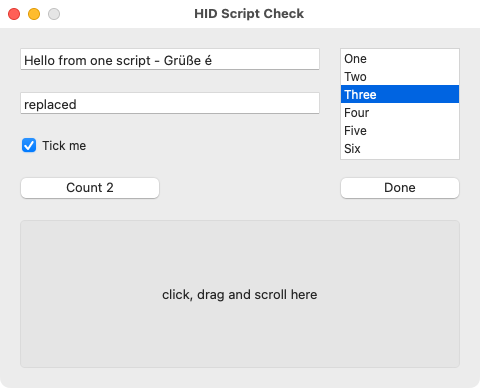
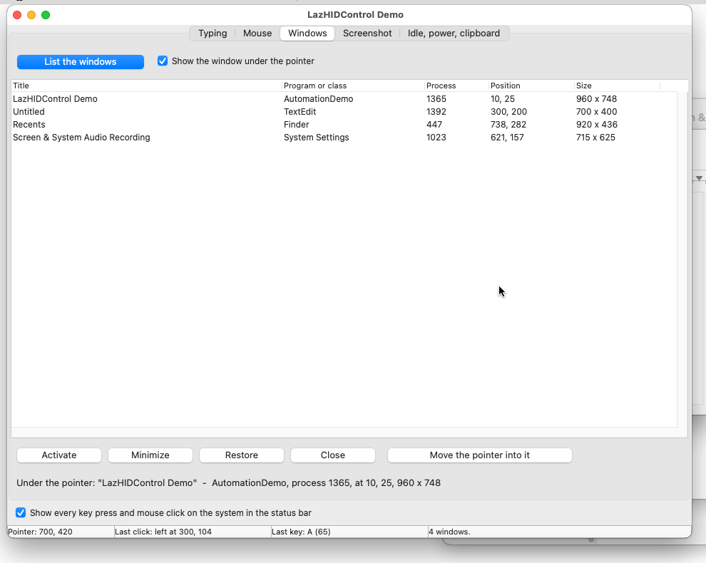
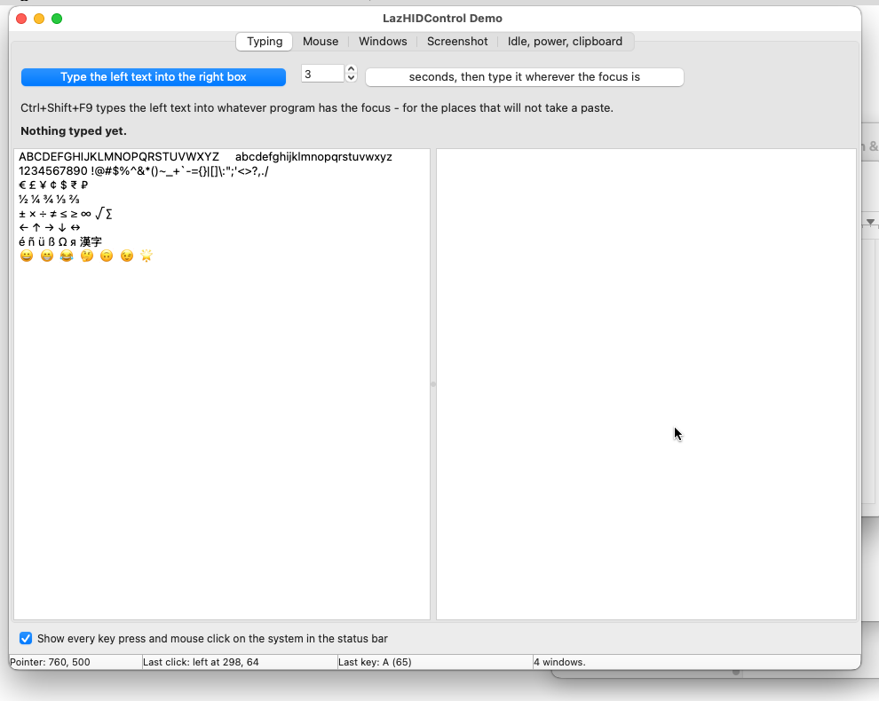

# LazHIDControl

Desktop automation for Lazarus / Free Pascal: type, click, scroll, register
global hotkeys, find and control other programs' windows, take screenshots,
and watch the clipboard, the power supply, and session idle time. Ten
nonvisual components to drop on a form, the library underneath them, and a
command-line tool that drives any program from a script.

The repository has three parts:

| | |
|---|---|
| [`hidctl/`](hidctl/) | The command-line automation tool. Covers most of what xdotool does, in one binary, using the same API you can call from Pascal. |
| [`lazhidcontrol/`](lazhidcontrol/) | The package: components, input backends, window management. |
| [`examples/`](examples/) | The demo program, with a tab for each area. |

## One script, every desktop

The same hidctl script file drives the same program on Linux, Windows and
macOS and gets the same result. [`tests/scriptcheck`](tests/scriptcheck/)
checks it: [check.hid](tests/scriptcheck/check.hid) types Unicode text,
selects with Shift, ticks a box, clicks a button twice, picks a list item
with the arrow keys, presses Ctrl+Shift+K, clicks, right-clicks,
double-clicks, drags and scrolls. The program writes down what reached it,
and that has to match [expected.txt](tests/scriptcheck/expected.txt) line
for line. On 16 October 2026 it did, with the script unchanged, on Linux
(GTK2 and GTK3 on X11), Windows 10 and macOS 15. These are the window at
the end of the script, one run on each:

| Linux, GTK3 | Windows 10 | macOS 15 |
|---|---|---|
|  |  |  |

What makes that work:

- **Coordinates count from the inside of the window**, below the title bar,
  on every system. Each system draws a different frame; none of them moves
  a click.
- **`scale lcl`** reads the script's coordinates as the Lazarus designer's
  numbers - the `Left` and `Top` in the `.lfm` - and grows them the way the
  LCL grows the form on a 125% screen. It is opt-in, in hidctl only; without
  it coordinates are plain pixels, as in xdotool.
- **`type` sends characters, not key positions**, so the text comes out
  right on any keyboard layout.

That makes it a tool for documentation as much as for testing. One script
walks a program through its screens and `shot` saves a picture at each
step under the name the script gives it; run it on each system and the
manual has a matching set of pictures from each, retaken in minutes after
every change to the program.

What does not carry from one system to another, and a portable script
avoids:

- shortcuts that differ by system: Ctrl+A is "start of line" in a Mac text
  field, and the Mac's own shortcuts use Command;
- the End key on its own in a Mac text field, which scrolls rather than
  moving the caret; click past the end of the text instead;
- things placed by their size: list rows and menu items are different
  heights on each widget set, so choose them with the arrow keys;
- a form with a main menu: on Linux the menu bar is inside the window, so
  there a click counts from the top of the menu bar;
- Wayland: no program is told where windows are, so window-relative
  commands cannot work there; keys and screen coordinates do.

A drive script can be written three ways, all running the same code
underneath:

- **a hidctl script**, plain text, one command a line - [hidctl](#hidctl);
- **a Pascal program** using the package, built once for each system -
  [`tests/inputcheck.lpr`](tests/inputcheck.lpr) is one;
- **an instantfpc script**: Pascal run straight from its source, like a
  shell script. Point instantfpc at the compiled units once
  (`INSTANTFPCOPTIONS="-Fu<lazarus>/lcl/units/x86_64-linux
  -Fu<lazarus>/lcl/units/x86_64-linux/gtk2
  -Fu<lazarus>/components/lazutils/lib/x86_64-linux
  -Fu<this package>/lazhidcontrol/lib/x86_64-linux/gtk2 -dLCL -dLCLgtk2"`)
  and a file like this runs with `./drive.pas`. Tried on Linux only.

```pascal
#!/usr/bin/env instantfpc
program drive;
{$mode objfpc}{$H+}
uses
  cthreads, Interfaces, Types, Forms, Controls,
  HIDMouseAndKeyInput, WindowManager, WindowManagerIntf;
var
  W: TWindowHandle;
  Inside: TRect;
begin
  Application.Initialize;
  EnsureWindowManager;
  W := WindowMgr.FindWindow('HID Script Check');
  WindowMgr.ActivateWindow(W);
  Inside := WindowMgr.GetClientRect(W);
  MouseInput.Move([], Inside.Left + 150, Inside.Top + 32);
  MouseInput.Click(mbLeft, []);
  KeyInput.PressString('typed by a Pascal script');
end.
```

## The components

| | Component | What it does |
|---|---|---|
|  | `THIDHotkey` | Registers a global shortcut, configured in the Object Inspector; fires `OnHotkey` from any application. |
|  | `THIDKeyboard` | Types text - Unicode included - and sends keys with modifiers to the focused application. |
|  | `THIDMouse` | Moves, clicks, and scrolls; coordinates can be screen, control, or window relative. |
|  | `THIDWindow` | Finds windows by title, class, or process; waits for them, activates, moves, resizes. |
|  | `THIDScreenshot` | Captures the desktop, a monitor, a window, a rectangle, or a drag selection. |
|  | `THIDClipboardMonitor` | Fires `OnChanged` when the clipboard content changes, without reading it. |
|  | `THIDPowerMonitor` | Sleep and wake notifications, power source, battery percentage, charging. |
|  | `THIDSystemIdle` | Fires `OnIdle` and `OnActive` as session input stops and resumes. |
|  | `THIDInputMonitor` | Reports key presses and mouse clicks anywhere on the system, for recording a task to play back. |
|  | `THIDPermission` | Explains which permissions this desktop needs and requests them: the udev rule on Wayland through the system's password dialog, the Privacy & Security prompts on macOS. |

Every component has palette icons and Object Inspector hints on every
property, reports errors through `OnError` rather than dialogs, and does
nothing in the designer or at form load beyond what you enabled.

[MANUAL.md](MANUAL.md) covers each component in detail, the library beneath
them, and the per-platform notes.

## Install

Open `lazhidcontrol/lazhidcontrol.lpk` in Lazarus, **Compile**, then
**Use → Install** to put the components on the palette. For library-only use,
**Use → Add to Project** is enough. From a shell:

```sh
lazbuild --add-package-link lazhidcontrol/lazhidcontrol.lpk
lazbuild examples/automation/AutomationDemo.lpi
lazbuild hidctl/hidctl.lpi
```

Dependencies are `LCL` and `FCL`. Linux also needs the X11, Xtst and D-Bus
libraries, which every desktop has.

## Example

```pascal
// Drop a THIDWindow and a THIDMouse on a form, or create them in code:
if Window.Find then            // WindowTitle set in the Object Inspector
begin
  Window.Activate;
  Mouse.RelativeWindow := Window;
  Mouse.MoveTo(200, 150);      // 200,150 inside that window, wherever it is
  Mouse.Click;
end;
```

Or skip the components and use the library directly:

```pascal
uses HIDMouseAndKeyInput, LCLType;
KeyInput.PressString('Hello World!');
KeyInput.Press(VK_RETURN);
MouseInput.Move([], 100, 100, 500);  // move there over 500 ms
MouseInput.Click(mbLeft, []);
```

## hidctl

The same functions from a shell, on Linux, Windows and macOS. It accepts
xdotool's command names, chained on one line as xdotool does:

```sh
hidctl search --name "Text Editor" windowactivate key ctrl+a type "Hello" key Return
```

It also runs scripts, one command per line from a file or standard input,
with its own commands that use coordinates relative to the target window, so
a script still works when the window opens somewhere else.

```sh
./hidctl/hidctl --window "Some App" - <<EOF
waitfor 5000 Some App
at 300 200
click
type Hello from a script
shot /tmp/proof.png
power
EOF
```

It covers the pointer, the keyboard, window find/wait/activate/geometry,
screenshots of the window, the desktop, or an area, the clipboard, idle time,
and power status. `hidctl --help` prints every command;
[hidctl/README.md](hidctl/README.md) lists which xdotool commands it supports. We use it, against a nested X server, to drive the GUI tests of our
other projects.

## Build your own automation tool

The components are the parts of a desktop automation program of the
AutoHotkey kind, ready to drop on a form:

| The tool needs to | Component |
|---|---|
| start something on a key combination, from any program | `THIDHotkey` |
| type text and press keys | `THIDKeyboard` |
| move, click, drag and scroll | `THIDMouse` |
| find the program to work on, bring it forward, place it | `THIDWindow` |
| record what the user does, to play it back | `THIDInputMonitor`, then `THIDKeyboard` and `THIDMouse` |
| keep pictures for a log or a bug report | `THIDScreenshot` |
| keep a clipboard history | `THIDClipboardMonitor` |
| run jobs while the user is away | `THIDSystemIdle` |
| hold off on battery, carry on after sleep | `THIDPowerMonitor` |
| ask macOS or a Wayland desktop for permission, once | `THIDPermission` |

A text expander, whole: a `THIDHotkey` with `ShortCut` Ctrl+Alt+D and
`Enabled` ticked, a `THIDKeyboard` beside it, and

```pascal
procedure TForm1.HIDHotkey1Hotkey(Sender: TObject);
begin
  HIDKeyboard1.TypeText(FormatDateTime('yyyy-mm-dd', Date));
end;
```

The date is typed into whatever program has the focus. The keyboard lets go
of Ctrl and Alt first, though the user is still holding them.

hidctl itself is the larger example: one Pascal program of about 850 lines
over the same library, and its script reader is the start of a scripting
language for anyone who wants to build one.

## Compared with other tools

What each one documents, as of October 2026. Corrections are welcome.

| | Runs on | Wayland | Other programs' windows | Global hotkeys | Screenshots | Types any Unicode text | The user installs |
|---|---|---|---|---|---|---|---|
| **LazHIDControl / hidctl** | Linux, Windows, macOS | typing, mouse, screenshots, watching keys (KDE tested) | X11, Windows, macOS | X11, Windows, macOS | yes | yes, on any layout | nothing: one binary, or built into your program |
| xdotool | Linux and BSD, X11 | no | yes | no | no | yes | the xdotool package |
| ydotool | Linux | typing, mouse | no | no | no | no, US layout key codes | a daemon with access to `/dev/uinput` |
| AutoHotkey | Windows | - | yes | yes | finds pixels and pictures; no saving | yes | AutoHotkey, or a compiled script |
| AutoIt | Windows | - | yes | yes | yes | yes | AutoIt, or a compiled script |
| PyAutoGUI | Windows, macOS, Linux X11 | no | Windows only | no | yes, and finds pictures | no, keys it can name | Python and its packages |

Many of the gaps in that table are the systems' rules rather than the
tools' faults, and they bind every tool the same way:

- **Wayland** tells no program where windows are, offers global hotkeys only
  to installed applications through its portal, and lets a program watch
  the keyboard only with a rule from the administrator. Every tool on
  Wayland goes through the same doors: the desktop's portals, or the
  kernel's `/dev/uinput` with permission. This package uses both, asks
  through the system's own dialogs, and goes as far as those doors allow.
- **macOS** makes the user allow each program under Privacy & Security
  before it may type, click, watch keys or read the screen. No tool gets
  round that.
- **Windows** stops a program from sending input to one running as
  administrator unless it is running as administrator too.

Where other tools are ahead, plainly:

- **Reading the program back.** AutoIt, AutoHotkey and pywinauto read
  controls on Windows - a button by its name, an edit box's text - so a
  script can check what happened and find a button that moved. hidctl
  clicks positions and cannot read anything back; `tests/scriptcheck` can
  check its results only because the program under test writes them down.
  The systems' accessibility interfaces (UI Automation, macOS Accessibility,
  AT-SPI) are the way to that; it is not built.
- **Seeing the screen.** SikuliX, PyAutoGUI and AutoHotkey find a picture on
  the screen and click it. hidctl takes pictures but does not look at them.
- **Waiting for a thing instead of a time.** Browser tools such as
  Playwright wait until a button is ready. hidctl waits for a window to
  appear (`waitfor`), and otherwise for a fixed time.
- **A language.** AutoHotkey has variables, loops and functions. A hidctl
  script is a list of commands; loops and sums come from the shell that
  writes it, or the script is a Pascal program instead.
- **A recorder.** `THIDInputMonitor` hears every key and click, but there is
  no program yet that turns a recording into a script.

## What is tested, what is not

| | Linux / X11 | Windows | macOS | Linux / Wayland |
|---|---|---|---|---|
| Tested on | Mint, in a nested X server; GTK2 and GTK3. Qt5 on Ubuntu 26.04 with its own Lazarus 4.4 and FPC 3.2.2 | Windows 10, in a virtual machine | macOS 15 on Intel, in a virtual machine; Lazarus 4.8, FPC 3.2.4 | KDE Plasma 6 on Ubuntu 26.04, in a virtual machine; GTK3 |
| Typing, Unicode included | ✅ on US, German, French, Spanish and Russian layouts | ✅ | ✅ | ✅ on KDE; the desktop asks the user once when the text goes beyond ASCII |
| Keys with Ctrl, Alt, Shift | ✅ | ✅ | ✅ | ✅ |
| Mouse: move, click, scroll | ✅ | ✅ | ✅ | ✅ in screen coordinates |
| Back and forward mouse buttons | ✅ GTK2 and Qt5; a GTK3 Lazarus program does not receive them, a fault in the LCL | ✅ | not passed on in the virtual machine | not tried |
| Global hotkeys | ✅ | ✅ | ✅ | not written; the portal serves only installed applications |
| Windows: find, activate, move, size, minimize | ✅ | ✅ | ✅ | not possible on Wayland |
| Screenshots | ✅ | ✅ | ✅ | ✅ through the desktop's portal; it asks the user once |
| Clipboard monitoring | ✅ | ✅ | ✅ | ✅ through XWayland, which passes on what Wayland programs copy |
| Idle time | ✅ | ✅ | ✅ | ✅ on KDE; GNOME untested |
| Power status | ✅ | ✅ | ✅ | ✅ |
| Sleep and wake events | ✅ | not tried | not tried | not tried |
| Watching keys and clicks system-wide, for recording a task to replay | ✅ | ✅ | ✅ | ✅ keys and buttons from the kernel's input devices, once `THIDPermission` has installed its rule; no click positions |
| hidctl | ✅ | ✅ | ✅ | ✅ for what the rows above allow |
| One hidctl script, unchanged, same result (`tests/scriptcheck`) | ✅ GTK2 and GTK3 | ✅ | ✅ | not possible: no window positions |

Qt5 builds pass the same input, hotkey and clipboard checks as GTK2 on
X11. Qt6 has not been tried.

The keyboard, mouse and hotkey rows were checked again on 15 October 2026,
after those units were rewritten: on Linux (GTK2, GTK3 and Qt5) and Windows
with the two test programs below, on macOS with the hotkey test and by typing
into TextEdit, and on Wayland by typing and clicking into KWrite with
hidctl.

`tests/inputcheck` types into its own window and clicks, drags and scrolls on
its own controls, then checks what arrived (29 checks); `tests/hotkeycheck`
registers global hotkeys and presses them (23); `tests/scriptcheck/run.sh`
(`run-windows.ps1` on Windows) drives a small program with one hidctl script
and compares what arrived (11 lines). All take over the keyboard and mouse,
so run them in a nested X server or a virtual machine; `run.sh` starts its
own nested X server on Linux.

**On a Mac the user has to allow it.** macOS asks before a program may do
any of this to other programs, under System Settings > Privacy & Security:
*Accessibility* for typing, the mouse and moving windows, *Input Monitoring*
for watching keys, *Screen Recording* for screenshots that show other
programs' windows. Hotkeys, the clipboard, idle time and power need nothing.
Without a permission the call fails or comes back empty; nothing crashes.
One Mac difference: a minimized window is not in the window list, so keep
its handle if you mean to bring it back.

**On Wayland the user grants access once**, through a prompt the package
starts. Which prompt depends on what the program does:

- *Typing and the mouse only:* the desktop's own "may this program control
  input devices" question, through its RemoteDesktop portal, the first time
  input is sent. No password, no system file, and the desktop remembers the
  answer for that program. `THIDKeyboard.PermissionNote` is shown just
  before it, to say why. Desktops without that portal - the wlroots ones,
  such as Sway - take the password route below instead.
- *Watching keys and clicks as well:* there is no portal for watching, so
  that takes a small udev rule, and the same password installs a second
  rule that lets typing and the mouse go through the kernel's virtual
  devices, so the portal prompt is not used. Drop
  `THIDPermission` on the form with both needs and call `Ask`: it shows the
  user what is being allowed and the exact files, then the system's own
  password dialog installs them. The manual has the rules for anyone who
  would rather write them by hand.

One exception: a virtual keyboard presses keys, not characters, so text
beyond ASCII still goes through the desktop's portal prompt the first time. Set `THIDKeyboard.WaylandUnicode` off and it never does;
`TypeText` refuses such text instead.

Text sent through the virtual keyboard is typed with a US layout. Wayland
does not tell a program where windows are, its own included, so the mouse
works in screen coordinates only and other programs' windows cannot be
targeted. Screenshots come from the desktop's portal. KDE Plasma 6 is
what was tested; GNOME and other desktops have not been, and
[reports are welcome](https://github.com/TonyStone31/LazHIDControl/issues).

**Still wanted on Wayland: where the pointer is.** No Wayland desktop tells
a program that, so `THIDInputMonitor` does not watch clicks there - its
`OnError` says why - and a recorder cannot say where anything was clicked. Per-desktop workarounds exist, and this package
does not use them: it has to work the same everywhere with nothing extra to
install. The only option that does is the desktop's screen-sharing portal,
which can report the cursor alongside the screen - [TODO.md](TODO.md) has
the plan, the costs and a first step, for anyone who wants to take it on.

**Still wanted from a real Mac:** Apple Silicon, battery changes, and
sleep/wake events - a virtual machine has none of them. `sh tests/run_macos.sh`
runs the checks.

The demo on macOS, listing the Mac's windows and showing its typing test sheet:





## Where it started

LazHIDControl began from LazMouseAndKeyInput, the package Tom Gregorovic
wrote in 2008 that ships with Lazarus in `components/mouseandkeyinput`,
with its Cocoa units by Sammarco Francesco. Global hotkeys adapted from the
Codebot library by Anthony Walter were added to it. Much of what this
package knows about sending input on each system was learned from reading
their code.

It has come a long way since. What began as typing and clicking is now ten
components, window control, screenshots, clipboard, power and idle
monitoring, watching keys and clicks system-wide, Wayland through the
desktop's portals and the kernel's input devices, and hidctl.

In October 2026 the last of the borrowed code was replaced. The keyboard,
mouse and hotkey units were written new from a written description of what
they must do, by a writer who had not seen the earlier code. That was not
because the old code was bad - it worked, and this package rests on what it
taught. It was because that code was under the GPL, and this package is
meant to be usable in any program. On the package's own tests the new units
do at least as well as the old ones on every platform.

Components, window management, hidctl, and everything since: Tony Stone.

## License

[0BSD](LICENSE): use it in anything, open or closed, with or without
credit. Releases before October 2026 were GPL-2.0-or-later, and copies of
those stay under it.
